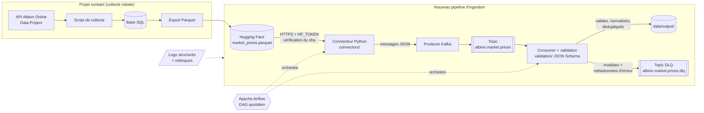

# Étape 1 – Cadrage du besoin

## 1.1. Contexte du projet

Dans le cadre de ce projet, nous souhaitons mettre en place une chaîne de collecte et d'ingestion de données permettant de récupérer, transporter, contrôler et stocker des données structurées.

Pour réaliser ce travail, nous allons nous appuyer sur un projet précédemment développé autour du jeu vidéo **Albion Online**. Ce projet avait pour objectif de récupérer les données du marché du jeu à partir de son API, afin de suivre les prix des différents objets disponibles dans les villes du jeu.

Les données récupérées étaient ensuite enregistrées dans une base de données SQL. À partir de cette base, un export était réalisé au format **Parquet**, avant de publier les fichiers sur la plateforme Hugging Face pour les rendre accessibles et réutilisables.

Nous allons donc réutiliser les données produites par ce premier projet comme source d'entrée pour notre nouvelle chaîne d'ingestion.

La source utilisée est le dataset Hugging Face suivant :

**Albion Online Market Prices**  
https://huggingface.co/datasets/Sayli84/albion-online-market-prices

Ce choix permet de travailler sur des données réelles issues d'une collecte existante, tout en séparant le processus de collecte initial de celui de l'ingestion et du traitement.

## 1.2. Besoin métier et problématique analytique

Le marché d'Albion Online évolue régulièrement en fonction de l'offre et de la demande des joueurs. Les prix des objets peuvent varier selon les villes, leur qualité et les périodes d'observation.

L'exploitation de ces données permet notamment :
- De comparer les prix d'un même objet entre différentes villes.
- D'étudier les variations des prix minimums et maximums.
- De comparer les prix d'achat et de vente.
- D'identifier des opportunités potentielles d'achat et de revente.
- De mieux comprendre l'évolution du marché du jeu.

La problématique principale de notre projet est donc la suivante :

**Comment mettre en place une chaîne d'ingestion automatisée et fiable permettant de récupérer les données du marché d'Albion Online depuis Hugging Face, de les transporter avec Kafka, de les traiter et de contrôler leur qualité ?**

L'objectif est également de rendre le processus reproductible grâce à Airflow et de pouvoir identifier les éventuelles erreurs pendant l'ingestion.

## 1.3. Identification de la source de données

La source de données utilisée est le dataset *Albion Online Market Prices*, hébergé sur Hugging Face.

| Caractéristique | Description |
|---|---|
| Source initiale | API du marché d'Albion Online |
| Projet de collecte | Projet personnel Albion Online |
| Stockage initial | Base de données SQL |
| Format des fichiers | Parquet |
| Hébergement | Hugging Face |
| Nom du dataset | Sayli84/albion-online-market-prices |
| Fichier | `data/market_prices.parquet` (fichier unique) |
| Taille approximative | 431 Ko |
| Nombre de lignes | 47 926 |
| Périmètre | Serveur européen d'Albion Online |
| Accès | Dataset public mais à accès contrôlé (*gated*) : authentification par token Hugging Face obligatoire |
| Fréquence de mise à jour | Publication ponctuelle par snapshot (dernière mise à jour : 6 novembre 2026) |
| Type de données | Données structurées sur les prix du marché |

Les fichiers Parquet contiennent les informations suivantes :

| Colonne | Description |
|---|---|
| `item_id` | Identifiant de l'objet dans le jeu |
| `city` | Ville dans laquelle le prix est observé |
| `quality` | Niveau de qualité de l'objet |
| `sell_price_min` | Prix minimum de vente |
| `sell_price_min_date` | Date associée au prix minimum de vente |
| `sell_price_max` | Prix maximum de vente |
| `sell_price_max_date` | Date associée au prix maximum de vente |
| `buy_price_min` | Prix minimum d'achat |
| `buy_price_min_date` | Date associée au prix minimum d'achat |
| `buy_price_max` | Prix maximum d'achat |
| `buy_price_max_date` | Date associée au prix maximum d'achat |

Types observés dans le fichier : `item_id` et `city` sont des chaînes, `quality` un entier de 1 à 5, les prix des décimaux (`double`) et les dates des `timestamp` sans fuseau horaire. Le fichier couvre 8 villes, dont le **Black Market**, et des observations allant du 3 au 4 novembre 2026.

Le format Parquet a été conservé dans le projet initial pour stocker les données de manière structurée et compacte. Dans le nouveau pipeline, ces données seront lues avec Python, puis transformées en messages JSON pour être envoyées dans Kafka.

### Accès à la source

- **Protocole** : HTTPS, via la bibliothèque `huggingface_hub` (ou l'URL `https://huggingface.co/datasets/Sayli84/albion-online-market-prices/resolve/main/data/market_prices.parquet`).
- **Authentification** : le dataset est *gated*. Une requête anonyme renvoie une erreur `401`. Il faut un compte Hugging Face ayant accepté les conditions d'accès, ainsi qu'un token de lecture. Ce token est fourni par variable d'environnement (`HF_TOKEN`, dans un fichier `.env`) et n'est jamais versionné dans le dépôt.
- **Fichier de données non versionné** : le Parquet est téléchargé dans `data/input/` à chaque exécution et ignoré par Git. Le versionner rendrait le dataset accessible sans passer par le contrôle d'accès de Hugging Face, ce que la consigne déconseille aussi.
- **Détection des nouveautés** : l'API Hugging Face (`/api/datasets/Sayli84/albion-online-market-prices`) expose le hash du dernier commit (`sha`) et la date `lastModified`. Le connecteur pourra ainsi savoir si le fichier a changé depuis la dernière ingestion sans le retélécharger.

### Limites de la source

- **Pas de temps réel** : le fichier est un snapshot figé. Il ne reflète l'état du marché qu'au moment de son export depuis la base SQL.
- **Pas d'incrémental natif** : le fichier est remplacé en entier à chaque publication. L'extraction incrémentale doit donc se faire côté pipeline (comparaison du `sha` et déduplication sur une clé métier).
- **Données collaboratives** : les prix de l'Albion Online Data Project proviennent des clients des joueurs. Certains couples objet / ville / qualité peuvent être absents ou anciens.
- **Prix manquants** : quand aucun ordre n'existe, le prix vaut `0.0` et la date associée est nulle. C'est le cas pour 70 % des prix de vente (33 401 lignes) et 84 % des prix d'achat (40 205 lignes). La validation devra traiter ces valeurs comme des absences de prix, et non comme des prix gratuits.
- **Doublons dans la source** : 280 combinaisons `item_id` / `city` / `quality` apparaissent plusieurs fois dans le fichier (47 640 combinaisons distinctes pour 47 926 lignes). La déduplication est donc nécessaire.
- **Dépendance à un service tiers** : la disponibilité de Hugging Face, les limites de débit et le jeton d'accès peuvent provoquer des erreurs de téléchargement. Le connecteur devra donc gérer les reprises.
- **Périmètre limité** : seul le serveur européen est couvert.

## 1.4. Analyse des caractéristiques des données : volume, vélocité et variété

Les données peuvent être caractérisées selon les trois dimensions suivantes :

**Volume**

Le dataset contient 47 926 lignes pour une taille totale d'environ 431 Ko. Ce volume reste relativement faible, ce qui permet de réaliser les traitements avec des ressources informatiques limitées. Il est néanmoins suffisant pour tester les mécanismes d'ingestion, de transport et de validation de Kafka.

**Vélocité**

Dans le projet initial, les données étaient récupérées régulièrement depuis l'API du marché d'Albion Online. Les fichiers Parquet publiés sur Hugging Face sont donc issus de collectes périodiques.

Côté Hugging Face, la vélocité est faible : le dataset est publié sous forme de snapshot, sans flux continu. Nous planifierons donc une vérification **quotidienne**. Si le `sha` du dataset n'a pas changé depuis la dernière exécution, le pipeline s'arrête sans rien republier. S'il a changé, le fichier complet est réingéré.

**Variété**

Les données sont structurées sous forme de colonnes dans des fichiers Parquet. Elles contiennent des identifiants d'objets, des villes, des niveaux de qualité, des prix et des dates d'observation. Il s'agit donc principalement de données numériques et textuelles organisées selon un schéma défini.

La variété est faible : une seule source, un seul format et un schéma stable.

| Dimension | Niveau | Conséquence pour le pipeline |
|---|---|---|
| Volume | Faible (47 926 lignes, environ 431 Ko) | Traitement en mémoire avec pandas, sans moteur distribué |
| Vélocité | Faible (snapshots ponctuels) | Ingestion par lots planifiée, pas de streaming temps réel |
| Variété | Faible (Parquet, schéma fixe) | Un contrat de données unique (JSON Schema) suffit |

## 1.5. Choix du mode d'ingestion

Nous avons choisi une ingestion par lots (*batch ingestion*) à partir des fichiers Parquet disponibles sur Hugging Face.

Ce choix est cohérent avec notre source, puisque nous exploitons des fichiers déjà générés par le projet précédent, et non un flux directement connecté à l'API du jeu.

| Pattern | Adapté ? | Justification |
|---|---|---|
| **Batch (par lots)** | ✅ Retenu | La source est un fichier complet publié ponctuellement. Le volume est faible et il n'y a pas d'exigence de temps réel. |
| Streaming temps réel | ❌ | La source n'émet aucun flux d'événements. Interroger en continu un fichier statique n'apporterait rien. |
| Micro-batch | ❌ | Il n'y a rien à découper finement : le fichier change en bloc. |
| CDC (*Change Data Capture*) | ❌ | Nous n'avons pas accès au journal de la base SQL d'origine, seulement à l'export Parquet. |

Kafka reste pertinent malgré l'ingestion par lots. Il découple la lecture de la source du traitement et rend possible le rejeu des messages (rétention des offsets). Il permet aussi d'isoler les messages invalides dans un topic DLQ dédié.

Le fonctionnement prévu est le suivant :

1. Récupération du dataset Parquet depuis Hugging Face.
2. Lecture du fichier avec Python.
3. Vérification et normalisation des données.
4. Transformation de chaque ligne en message JSON.
5. Publication des messages dans un topic Kafka.
6. Consommation des messages et validation de leur structure.
7. Stockage des données valides et envoi des données invalides dans une Dead Letter Queue (DLQ).

Airflow sera utilisé pour orchestrer et planifier les différentes étapes du pipeline. Des mécanismes de journalisation et de suivi permettront également de contrôler les traitements et de détecter les erreurs.

## 1.6. Architecture générale envisagée

L'architecture globale repose sur deux parties complémentaires.

La première correspond au projet Albion déjà réalisé, qui assure la collecte initiale des données :

**API Albion Online → Script de collecte → Base de données SQL → Export Parquet → Hugging Face**

La deuxième correspond au nouveau projet d'ingestion :

**Hugging Face → Connecteur Python → Kafka → Consommateur → Validation et traitement → Stockage des résultats**



> Les topics, partitions et clés sont détaillés et justifiés à l'étape 3.

Apache Airflow interviendra pour orchestrer les différentes étapes du nouveau pipeline. Kafka assurera le transport des messages, tandis que le système de validation permettra de distinguer les données conformes des données invalides. Ces dernières seront isolées dans une DLQ afin de pouvoir être analysées.

Cette architecture permet de réutiliser un travail existant tout en construisant une nouvelle chaîne d'ingestion indépendante, automatisée et contrôlable.
# Étape 3 – Transport des données avec Kafka

## 3.1. Topics

| Topic | Partitions | Rétention | Rôle |
|---|---|---|---|
| `albion.market.prices` | 3 | 7 jours | Prix du marché, un message par couple objet / ville / qualité |
| `albion.market.prices.dlq` | 1 | 30 jours | *Dead-Letter Queue* : messages rejetés, avec les métadonnées de leur erreur |

Les topics sont décrits dans [`kafka/scripts/config.py`](kafka/scripts/config.py) et créés par [`kafka/scripts/create_topics.py`](kafka/scripts/create_topics.py). Ce script peut être relancé sans risque : un topic déjà existant est conservé tel quel.

**Pourquoi 3 partitions pour les prix ?** Le volume (47 926 messages par lot) tiendrait sur une seule partition. Avec 3 partitions, on peut lancer jusqu'à 3 consumers en parallèle dans le même groupe si le volume augmente, par exemple en ajoutant d'autres serveurs du jeu. Ce nombre reste assez faible pour un seul broker et permet de vérifier concrètement la répartition des messages. Dans Kafka, on peut augmenter le nombre de partitions plus tard mais jamais le diminuer : partir petit est donc le choix prudent.

**Pourquoi 1 partition pour la DLQ ?** Les rejets doivent rester rares. Une seule partition garde leur ordre d'arrivée, ce qui facilite l'analyse.

**Rétention.** Les 7 jours du topic des prix permettent de rejouer un lot récent en cas de problème en aval. Les 30 jours de la DLQ laissent le temps d'analyser et de corriger les rejets.

**Réplication.** Le facteur de réplication est de 1, car le `docker-compose.yml` ne lance qu'un seul broker. En production, on utiliserait 3 brokers, un facteur de réplication de 3 et `min.insync.replicas=2`.

## 3.2. Clé de message

La clé est `item_id|city|quality` (exemple : `T4_BAG|Caerleon|1`). C'est la clé métier d'une observation de prix.

- **Ordre garanti par objet.** Tous les messages d'une même clé vont dans la même partition. Leur ordre est donc conservé, et une nouvelle observation d'un prix arrive toujours après l'ancienne.
- **Déduplication facilitée.** Deux messages de même clé et de mêmes dates sont des doublons. L'étape de qualité peut les éliminer sur ce critère.
- **Bonne répartition.** Il y a des milliers de clés différentes, donc le hachage les distribue de façon équilibrée. Avec `item_id` seul, la répartition serait plus grossière. Avec `city` seul, il n'y aurait que 7 valeurs, ce qui donnerait des partitions déséquilibrées.

Les champs de la clé sont lus dans l'enveloppe `data` du message (voir 3.3). Un message auquel il manque un champ de la clé n'est pas publié. Il est comptabilisé dans `skipped`.

## 3.3. Producer et consumer

| Script | Rôle |
|---|---|
| [`producer.py`](kafka/scripts/producer.py) | Publie les messages du connecteur (étape 2). En ligne de commande : `--source connector` pour les vraies données Hugging Face, ou `--source <fichier.jsonl>` pour un fichier JSON Lines. En Python : `publish(extract_data(), run_id=...)`. |
| [`consumer.py`](kafka/scripts/consumer.py) | Lit le topic des prix et écrit les messages dans `data/output/market_prices.jsonl`. Un message illisible est envoyé dans la DLQ. Le script s'arrête après une période sans message, ce qui le rend utilisable depuis Airflow. |
| [`check_topics.py`](kafka/scripts/check_topics.py) | Affiche, pour chaque partition, le nombre de messages, l'offset commité et le *lag* (messages restant à lire). |
| [`generate_sample.py`](kafka/scripts/generate_sample.py) | Génère un jeu fictif de 300 lignes au format du connecteur (`data/input/sample_market_prices.jsonl`), pour tester Kafka sans token Hugging Face. |

**Format d'un message.** La valeur reprend l'enveloppe produite par le connecteur, sérialisée en JSON. Les timestamps du Parquet sont convertis au format ISO 8601.

```json
{
  "source": "HF_albion_online_market_prices",
  "dataset_sha": "7bec455e16acef0b4646d33a0ef646a53759ebc5",
  "extract_date": "2026-11-27T10:19:38.287640+00:00",
  "data": {
    "item_id": "T3_MAIN_ARCANESTAFF", "city": "Black Market", "quality": 2,
    "sell_price_min": 0.0, "sell_price_min_date": null,
    "sell_price_max": 0.0, "sell_price_max_date": null,
    "buy_price_min": 708.0, "buy_price_min_date": "2026-11-04T06:45:00",
    "buy_price_max": 3658.0, "buy_price_max_date": "2026-11-04T06:45:00"
  }
}
```

Les métadonnées techniques propres à Kafka sont placées dans les *headers*, pour ne pas les mélanger avec les données :

| Header | Contenu |
|---|---|
| `message_id` | UUID unique du message : identifiant de corrélation, réutilisable à l'étape 6 |
| `run_id` | Identifiant du lot (par exemple l'identifiant du run Airflow) |
| `produced_at` | Horodatage UTC de la publication |
| `source` | Recopié du champ `source` du message |
| `dataset_sha` | Version du dataset Hugging Face d'où vient le message |

Un message envoyé dans la DLQ conserve ses headers d'origine. On y ajoute `error`, `error_stage`, `original_topic`, `original_partition`, `original_offset` et `failed_at`.

## 3.4. Vérification

**Test 1 : données réelles.** Le fichier `market_prices.parquet` (47 926 lignes) passe par le connecteur de l'étape 2, plus le jeu d'exemple (300 lignes) :

```
$ python kafka/scripts/producer.py --source connector
"sent": 47926, "delivered": 47926, "failed": 0, "skipped": 0,
"per_partition": {"0": 15915, "1": 15963, "2": 16048}

$ python kafka/scripts/consumer.py
"consumed": 48226, "written": 48226, "dlq": 0

$ python kafka/scripts/check_topics.py
albion.market.prices  (3 partition(s), 48226 message(s))
  partition  messages   part   commité    lag
          0     16004    33%     16004      0
          1     16062    33%     16062      0
          2     16160    34%     16160      0
```

- **Publication** : les 47 926 lignes réelles ont été livrées, sans échec ni ligne écartée.
- **Consommation** : le lag est à 0 sur toutes les partitions, donc tout a été lu.
- **Répartition** : 33 % / 33 % / 34 %. La clé répartit les messages de façon équilibrée, et aucune clé ne se retrouve sur deux partitions différentes.

**Test 2 : message invalide.** Un message qui n'est pas du JSON (`{pas du json`) est injecté avec `kafka-console-producer` :

```
$ python kafka/scripts/consumer.py
"consumed": 301, "written": 300, "dlq": 1
```

Le message est arrivé dans la DLQ avec l'erreur `JSON invalide : Expecting property name…` et sa position d'origine (partition 1, offset 95).

Les messages sont aussi visibles dans Kafka-UI : http://localhost:8081.

> Le lag affiché pour la DLQ est normal : aucun consumer ne lit encore ce topic. Son traitement relève de l'étape 5.

## 3.5. Stratégie de reprise et risques de doublons

**Côté producer**
- `enable.idempotence=true` et `acks=all` : si un envoi échoue (coupure réseau, broker lent), le producer le renvoie automatiquement, jusqu'à 10 tentatives en 2 minutes au maximum. Kafka élimine les doublons créés par ces renvois.
- Si la file d'envoi locale est pleine, le producer attend et réessaie au lieu de perdre le message.
- À la fin, `publish()` renvoie le nombre de messages livrés et en échec. La tâche Airflow pourra échouer, puis être relancée, si `failed > 0`.

**Côté connecteur : extraction incrémentale par `sha`**

Le dataset est remplacé en entier à chaque publication. On ne peut donc pas extraire « seulement les nouvelles lignes ». On ne republie le fichier que s'il a changé :

1. `check_new_version()` lit le `sha` actuel du dataset dans l'API Hugging Face. Ces métadonnées sont publiques : aucun token n'est nécessaire à cette étape.
2. Il compare ce `sha` à celui de la dernière ingestion réussie, enregistré dans `data/state/last_ingested.json`.
3. Si le `sha` est identique, rien n'est publié (`"status": "unchanged"`).
4. Sinon, le fichier est téléchargé **à cette version précise** (`revision=sha`). On est ainsi sûr que les données correspondent bien au `sha` enregistré.
5. Le `sha` n'est enregistré qu'une fois **tous** les messages livrés à Kafka. Si la publication échoue, la version n'est pas marquée et sera republiée au prochain lancement.

| Scénario testé | Résultat |
|---|---|
| Première ingestion | 47 926 messages publiés, `sha` enregistré (`status: ingested`) |
| Relance, dataset inchangé | 0 message publié (`status: unchanged`) |
| Kafka arrêté pendant la publication | 47 926 échecs, `sha` **non** enregistré (`status: failed`) |
| Relance après le retour de Kafka | 47 926 messages publiés, `sha` enregistré |
| `--force` | Republication même sans changement, pour rejouer un lot volontairement |

Le dossier `data/state/` n'est pas versionné, car il décrit l'état d'une installation.

**Côté consumer : garantie « au moins une fois »**
- L'auto-commit est désactivé. Pour chaque lot de messages, le consumer : 1) écrit sur disque (avec `fsync`) et dans la DLQ, 2) commite seulement ensuite les offsets.
- **Arrêt avant le commit** : les messages déjà écrits sont relus au redémarrage. On obtient des doublons, mais aucune perte.
- **Arrêt avant l'écriture** : rien n'est commité, donc les messages sont relus. Il n'y a ni perte ni doublon.
- **Relance normale** : le consumer reprend à l'offset commité. Vérifié : une seconde exécution lit 0 message.

**Doublons qui subsistent, et comment les traiter**

| Cas | Cause | Traitement |
|---|---|---|
| Doublons présents dans le fichier source | 280 clés apparaissent plusieurs fois dans le Parquet | Déduplication à l'étape 5 |
| Crash du consumer entre l'écriture et le commit | Garantie « au moins une fois » | Déduplication à l'étape 5 sur la clé `item_id\|city\|quality` et les dates de prix |
| Relance du producer sur le même lot | Ne se produit plus qu'avec `--force`, ou après un échec partiel. Le fichier source est alors republié entièrement. Vérifié : republier les 300 lignes du jeu d'exemple ajoute 300 messages, sur les mêmes partitions. | Le connecteur ne publie pas si le `sha` du dataset n'a pas changé (voir plus haut), et la déduplication de l'étape 5 sert de filet de sécurité |
| Relance d'une tâche Airflow | Même cas que le précédent | `run_id` fixé par Airflow, plus les deux mécanismes ci-dessus |

Une garantie « exactement une fois » de bout en bout demanderait des transactions Kafka et une écriture transactionnelle en sortie. Pour un lot quotidien de petite taille, la combinaison « au moins une fois » et déduplication est plus simple, et suffit.

## 3.6. Lancer l'étape 3

```bash
# 1. Démarrer Kafka et Kafka-UI
docker compose up -d kafka kafka-ui

# 2. Environnement Python
python3 -m venv .venv && source .venv/bin/activate
pip install -r requirements.txt

# 3. Créer les topics
python kafka/scripts/create_topics.py

# 4a. Publier les vraies données (HF_TOKEN dans le fichier .env, voir étape 2)
#     Ne publie rien si le dataset n'a pas changé depuis la dernière ingestion.
python kafka/scripts/producer.py --source connector
python kafka/scripts/producer.py --source connector --force   # pour republier quand même

# 4b. ou publier le jeu d'exemple, sans token
python kafka/scripts/generate_sample.py
python kafka/scripts/producer.py --source data/input/sample_market_prices.jsonl

# 5. Consommer, puis vérifier la répartition et le lag
python kafka/scripts/consumer.py
python kafka/scripts/check_topics.py
```

Variables d'environnement disponibles :
- `KAFKA_BOOTSTRAP_SERVERS` : `localhost:9092` par défaut. Depuis un conteneur, comme Airflow, utiliser `kafka:29092`.
- `KAFKA_TOPIC_PRICES`, `KAFKA_TOPIC_DLQ` et `KAFKA_CONSUMER_GROUP` : noms des topics et du groupe de consumers.
