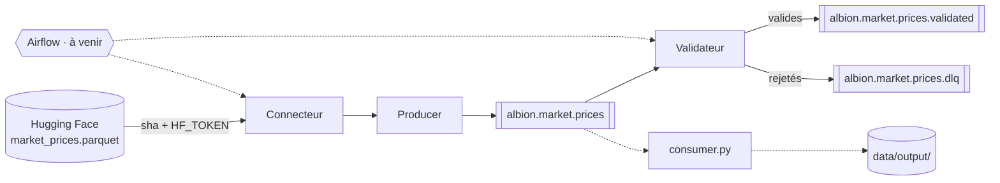

# Albion Online : pipeline d'ingestion Kafka

Pipeline batch qui récupère les prix du marché d'Albion Online depuis Hugging Face, les transporte avec Kafka, puis les valide et les normalise. Les messages rejetés sont isolés dans une DLQ.



## Démarrage rapide

```bash
docker compose up -d kafka kafka-ui                 # Kafka :9092, Kafka-UI http://localhost:8081
python3 -m venv .venv && source .venv/bin/activate
pip install -r requirements.txt
echo "HF_TOKEN=hf_xxx" > .env                       # token Hugging Face (dataset à accès contrôlé)

python kafka/scripts/create_topics.py
python kafka/scripts/producer.py --source connector # ne publie rien si le dataset n'a pas changé
python validation/validator.py                      # brut -> validated / DLQ
python kafka/scripts/check_topics.py                # messages, offsets et lag par partition
```

Sans token, on peut publier le jeu d'exemple : `python kafka/scripts/generate_sample.py`, puis `python kafka/scripts/producer.py --source data/input/sample_market_prices.jsonl`.

---

## Étape 1 · Cadrage

**Contexte.** Un projet précédent collecte les prix du marché d'Albion Online (API de l'Albion Online Data Project, puis base SQL, puis export Parquet) et les publie sur Hugging Face. Ce projet en réutilise la sortie comme source.

**Question analytique.** Comparer les prix d'un objet selon la ville, la qualité et le moment, et repérer les écarts entre l'achat et la vente pour trouver des opportunités d'achat-revente.

**Source** : [`Sayli84/albion-online-market-prices`](https://huggingface.co/datasets/Sayli84/albion-online-market-prices)

| | |
|---|---|
| Format | Un fichier Parquet, `data/market_prices.parquet` (431 Ko, 47 926 lignes) |
| Accès | HTTPS via `huggingface_hub`. Dataset *gated* : il faut un token (`HF_TOKEN` dans `.env`, jamais versionné) |
| Fréquence | Snapshot publié ponctuellement (dernière version : 6 novembre 2026), identifié par son `sha` |
| Périmètre | Serveur européen, 8 villes (dont le Black Market), qualités 1 à 5 |
| Colonnes | `item_id`, `city`, `quality`, et 4 prix (`sell`/`buy` × `min`/`max`), chacun avec sa date |

**Limites de la source**
- **Snapshot figé.** Le fichier ne contient pas de temps réel et il est remplacé en entier à chaque version : il n'y a pas d'extraction incrémentale native.
- **Prix souvent absents.** Un prix à `0` avec une date `null` signifie « aucun ordre ». C'est le cas pour 70 % des prix de vente et 84 % des prix d'achat.
- **Observations multiples.** 280 couples objet / ville / qualité apparaissent plusieurs fois, à des heures différentes. Ce sont des observations successives, **pas des doublons**.
- **Données collaboratives.** Les prix sont remontés par les joueurs : certains objets ou villes peuvent manquer.
- **Fichier non versionné.** Le Parquet n'est pas dans le dépôt, pour respecter le contrôle d'accès de Hugging Face.

**3V et choix du pattern**

| | Niveau | Conséquence |
|---|---|---|
| Volume | Faible (environ 48 000 lignes) | Traitement en mémoire, sans moteur distribué |
| Vélocité | Faible (snapshots ponctuels) | **Batch** quotidien. Pas de streaming : la source n'émet aucun flux |
| Variété | Faible (un format, un schéma) | Un seul contrat de données |

Le streaming, le micro-batch et le CDC sont écartés : le fichier change en bloc, et nous n'avons pas accès à la base SQL d'origine. Kafka reste utile pour découpler l'extraction du traitement, pour rejouer les messages et pour isoler les rejets.

## Étape 2 · Connecteur

[`connectors/albion_connector.py`](connectors/albion_connector.py)

- **Extraction incrémentale par `sha`.** Le connecteur lit la version du dataset sur l'API Hugging Face (publique, sans token) et la compare à la dernière version ingérée (`data/state/last_ingested.json`). Si elle n'a pas changé, il n'y a rien à faire.
- **Téléchargement à une version précise** (`revision=sha`), avec le token.
- **Messages structurés.** Chaque ligne devient `{source, dataset_sha, extract_date, data: {...}}`.
- **Sha enregistré en dernier.** Il n'est enregistré qu'une fois **tous** les messages livrés à Kafka. Si la publication échoue, la version sera retentée au prochain lancement.

| Scénario testé | Résultat |
|---|---|
| Première ingestion | 47 926 messages publiés, sha enregistré |
| Relance sans changement | 0 message publié |
| Kafka arrêté pendant la publication | Échec, sha **non** enregistré |
| Relance après le retour de Kafka | 47 926 messages publiés |

## Étape 3 · Kafka

| Topic | Partitions | Rétention | Rôle |
|---|---|---|---|
| `albion.market.prices` | 3 | 7 j | Messages bruts |
| `albion.market.prices.validated` | 3 | 7 j | Messages validés et normalisés (étape 5) |
| `albion.market.prices.dlq` | 1 | 30 j | Messages rejetés et raison du rejet |

- **3 partitions.** Une seule suffirait pour le volume actuel. Trois permettent de lancer 3 consumers en parallèle si le volume augmente. On peut ajouter des partitions plus tard, jamais en retirer.
- **1 partition pour la DLQ.** Les rejets sont rares, et une seule partition garde leur ordre d'arrivée.
- **Facteur de réplication de 1**, car il n'y a qu'un seul broker en local. En production : 3 brokers et `min.insync.replicas=2`.
- **Clé `item_id|city|quality`.** Toutes les observations d'un même objet tombent dans la même partition, donc dans l'ordre. La clé prend des milliers de valeurs, ce qui donne une répartition équilibrée : **33 % / 33 % / 34 %** mesurés.
- **Headers.** Chaque message porte `message_id` (identifiant de corrélation), `run_id`, `produced_at`, `source` et `dataset_sha`.

**Scripts** ([`kafka/scripts/`](kafka/scripts/))

| Script | Rôle |
|---|---|
| `create_topics.py` | Crée les topics. Peut être relancé sans effet |
| `producer.py` | Publie avec `--source connector` ou `--source fichier.jsonl`. `--force` republie même sans changement |
| `consumer.py` | Écrit les messages dans `data/output/`. Le JSON illisible part en DLQ |
| `check_topics.py` | Affiche messages, offset commité et lag par partition |
| `generate_sample.py` | Génère 300 lignes fictives pour tester sans token |

**Reprise et doublons**
- **Producer.** `enable.idempotence` et `acks=all` : les renvois automatiques (10 essais en 2 minutes) ne créent pas de doublon dans Kafka.
- **Consumer, « au moins une fois ».** Il écrit sur disque, puis commite l'offset. Un crash entre les deux provoque une relecture : des doublons possibles, mais jamais de perte.
- **Republication du même fichier.** Elle est évitée par le `sha` (étape 2), et le validateur l'absorbe dans tous les cas grâce au dédoublonnage (étape 5).

## Étape 4 · Airflow

À faire : un DAG quotidien qui enchaîne les topics, le connecteur et le producer, puis le validateur. Attention : le chemin des DAGs dans `docker-compose.yml` (`./dags`) doit être corrigé en `./airflow/dags`.

## Étape 5 · Qualité des données

Toute la validation se fait **après Kafka**, dans [`validation/validator.py`](validation/validator.py). Le topic brut garde tout, ce qui permet de rejouer la validation si une règle change, et chaque rejet reste traçable par sa partition et son offset.

```
albion.market.prices ─► désérialiser ─► valider ─► normaliser ─► dédoublonner ─┬─► .validated
                                                                                 └─► .dlq
```

**Contrat** : [`CONTRACT.md`](validation/CONTRACT.md) (sémantique, qualité, fraîcheur, évolution, version 1.0.0), [`market_price.schema.json`](validation/schemas/market_price.schema.json) (JSON Schema 2020-12) et [`rules.py`](validation/rules.py).
- **Schéma** :
  - champs obligatoires, `additionalProperties: false` ;
  - `city` dans une liste fermée (`enum`) ;
  - `quality` de 1 à 5 ;
  - prix entiers ≥ 0 ;
  - dates ISO 8601 ou `null`.
- **Règles métier** :
  - un prix > 0 a une date, et un prix à 0 n'en a pas ;
  - min ≤ max ;
  - la date doit exister ;
  - une observation n'est jamais postérieure à l'extraction.
- Le vrai fichier respecte toutes ces règles à 100 % : un rejet signale une vraie anomalie.

**Normalisation**
- Un prix à `0.0` devient `null`.
- `708.0` devient `708`.
- Les dates sont au format `…Z` (UTC).
- L'enveloppe est mise à plat.

**Dédoublonnage et idempotence**
- **Empreinte.** Un doublon est un message dont le contenu normalisé est identique, d'où une empreinte SHA-256 du contenu. La clé seule ne suffit pas : elle revient à chaque nouvelle observation.
- **Mémoire des messages traités** (`data/state/validator.sqlite`) : les empreintes pour les valides, les positions pour les rejets. Rejouer le topic ne produit aucun doublon.
- **Ordre pour chaque lot** : livrer les sorties, puis mémoriser, puis commiter l'offset.

**DLQ, format du cours.** Le corps du message contient `original_message`, `rejection_reason`, `errors`, `rejection_stage`, `rejection_timestamp`, `source_topic`, `source_partition`, `source_offset`, `validator_version` et `correlation_id`. On applique la quarantaine par défaut, une alerte au-delà de 5 %, et un arrêt immédiat en option (`--fail-on-alert`, code de sortie 2).

**Logs structurés (JSON)**
- Un WARNING par rejet, avec `error`, `field` et `correlation_id`.
- Un bilan INFO en fin d'exécution : `validation_rate`, `top_errors`, `latest_observation` (fraîcheur).
- Un WARNING « ALERTE » si plus de 5 % des messages sont rejetés.

**Tests.** `python validation/test_rules.py` vérifie un message valide et 15 cas invalides.

| Scénario de bout en bout | Résultat |
|---|---|
| Fichier réel et 8 messages invalides | 47 926 validés, 8 en DLQ avec leur WARNING |
| Rejeu complet (`--replay`) | 0 nouveau message, ni dans `validated` ni dans la DLQ |
| Republication du même fichier (`--force`) | 47 926 doublons détectés, 0 nouveau message |
| 3 rejets sur 15 messages (20 %) | ALERTE, et code de sortie 2 |
| Rejet d'un message publié par le producer | Son `correlation_id` et son `run_id` se retrouvent dans le log et dans la DLQ |

## Étapes 6 et 7 · À faire

- **Observabilité** : les logs structurés et le `correlation_id` existent déjà dans le validateur. Il reste à suivre les volumes, les erreurs et la fraîcheur, et à définir les seuils d'alerte de tout le pipeline.
- **Tests et documentation** : exécution de bout en bout avec le vrai token, et scénario d'erreur à préparer pour la soutenance.
- **Limite connue** : le connecteur ne réessaie pas encore automatiquement en cas d'erreur réseau vers Hugging Face. Il faut relancer l'exécution.

## Configuration

| Variable | Défaut |
|---|---|
| `HF_TOKEN` | — (dans `.env`) |
| `KAFKA_BOOTSTRAP_SERVERS` | `localhost:9092` (depuis un conteneur : `kafka:29092`) |
| `KAFKA_TOPIC_PRICES` / `KAFKA_TOPIC_VALIDATED` / `KAFKA_TOPIC_DLQ` | `albion.market.prices` / `.validated` / `.dlq` |
| `VALIDATION_ALERT_THRESHOLD` | `0.05` |

Jamais versionnés : `.env`, le Parquet téléchargé, `data/state/` et `data/output/`.
