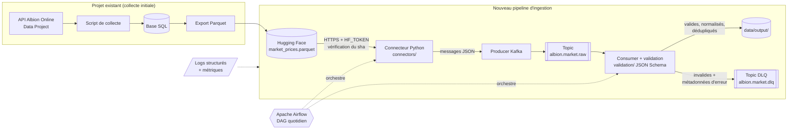

# Étape 1 – Cadrage du besoin

## 1.1. Contexte du projet

Dans le cadre de ce projet, nous souhaitons mettre en place une chaîne de collecte et d'ingestion de données permettant de récupérer, transporter, contrôler et stocker des données structurées.

Pour réaliser ce travail, nous allons nous appuyer sur un projet précédemment développé autour du jeu vidéo **Albion Online**. Ce projet avait pour objectif de récupérer les données du marché du jeu à partir de son API, afin de suivre les prix des différents objets disponibles dans les villes du jeu.

Les données récupérées étaient ensuite enregistrées dans une base de données SQL. À partir de cette base, un export était réalisé au format **Parquet**, avant de publier les fichiers sur la plateforme Hugging Face pour les rendre accessibles et réutilisables.

Nous allons donc réutiliser les données produites par ce premier projet comme source d'entrée pour notre nouvelle chaîne d'ingestion.

La source utilisée est le dataset Hugging Face suivant :

**Albion Online Market Prices**  
https://huggingface.co/datasets/Sayli84/albion-online-market-prices

Ce choix permet de travailler sur des données réelles issues d'une collecte existante, tout en séparant le processus de collecte initial de celui de l'ingestion et du traitement.

## 1.2. Besoin métier et problématique analytique

Le marché d'Albion Online évolue régulièrement en fonction de l'offre et de la demande des joueurs. Les prix des objets peuvent varier selon les villes, leur qualité et les périodes d'observation.

L'exploitation de ces données permet notamment :
- De comparer les prix d'un même objet entre différentes villes.
- D'étudier les variations des prix minimums et maximums.
- De comparer les prix d'achat et de vente.
- D'identifier des opportunités potentielles d'achat et de revente.
- De mieux comprendre l'évolution du marché du jeu.

La problématique principale de notre projet est donc la suivante :

**Comment mettre en place une chaîne d'ingestion automatisée et fiable permettant de récupérer les données du marché d'Albion Online depuis Hugging Face, de les transporter avec Kafka, de les traiter et de contrôler leur qualité ?**

L'objectif est également de rendre le processus reproductible grâce à Airflow et de pouvoir identifier les éventuelles erreurs pendant l'ingestion.

## 1.3. Identification de la source de données

La source de données utilisée est le dataset *Albion Online Market Prices*, hébergé sur Hugging Face.

| Caractéristique | Description |
|---|---|
| Source initiale | API du marché d'Albion Online |
| Projet de collecte | Projet personnel Albion Online |
| Stockage initial | Base de données SQL |
| Format des fichiers | Parquet |
| Hébergement | Hugging Face |
| Nom du dataset | Sayli84/albion-online-market-prices |
| Fichier | `data/market_prices.parquet` (fichier unique) |
| Taille approximative | 431 Ko |
| Nombre de lignes | Environ 47 000 |
| Périmètre | Serveur européen d'Albion Online |
| Accès | Dataset public mais à accès contrôlé (*gated*) : authentification par token Hugging Face obligatoire |
| Fréquence de mise à jour | Publication ponctuelle par snapshot (dernière mise à jour : 6 novembre 2026) |
| Type de données | Données structurées sur les prix du marché |

Les fichiers Parquet contiennent les informations suivantes :

| Colonne | Description |
|---|---|
| `item_id` | Identifiant de l'objet dans le jeu |
| `city` | Ville dans laquelle le prix est observé |
| `quality` | Niveau de qualité de l'objet |
| `sell_price_min` | Prix minimum de vente |
| `sell_price_min_date` | Date associée au prix minimum de vente |
| `sell_price_max` | Prix maximum de vente |
| `sell_price_max_date` | Date associée au prix maximum de vente |
| `buy_price_min` | Prix minimum d'achat |
| `buy_price_min_date` | Date associée au prix minimum d'achat |
| `buy_price_max` | Prix maximum d'achat |
| `buy_price_max_date` | Date associée au prix maximum d'achat |

Le format Parquet a été conservé dans le projet initial pour stocker les données de manière structurée et compacte. Dans le nouveau pipeline, ces données seront lues avec Python, puis transformées en messages JSON pour être envoyées dans Kafka.

### Accès à la source

- **Protocole** : HTTPS, via la bibliothèque `huggingface_hub` (ou l'URL `https://huggingface.co/datasets/Sayli84/albion-online-market-prices/resolve/main/data/market_prices.parquet`).
- **Authentification** : le dataset est *gated*. Une requête anonyme renvoie une erreur `401`. Il faut un compte Hugging Face ayant accepté les conditions d'accès, ainsi qu'un token de lecture. Ce token sera fourni par variable d'environnement (`HF_TOKEN`) et ne sera jamais versionné dans le dépôt.
- **Détection des nouveautés** : l'API Hugging Face (`/api/datasets/Sayli84/albion-online-market-prices`) expose le hash du dernier commit (`sha`) et la date `lastModified`. Le connecteur pourra ainsi savoir si le fichier a changé depuis la dernière ingestion sans le retélécharger.

### Limites de la source

- **Pas de temps réel** : le fichier est un snapshot figé. Il ne reflète l'état du marché qu'au moment de son export depuis la base SQL.
- **Pas d'incrémental natif** : le fichier est remplacé en entier à chaque publication. L'extraction incrémentale doit donc se faire côté pipeline (comparaison du `sha` et déduplication sur une clé métier).
- **Données collaboratives** : les prix de l'Albion Online Data Project proviennent des clients des joueurs. Certains couples objet / ville / qualité peuvent être absents ou anciens.
- **Valeurs par défaut** : l'API d'origine renvoie un prix à `0` et une date par défaut (`0001-01-01T00:00:00`) lorsqu'aucun ordre n'existe. Ces valeurs devront être détectées pendant la validation.
- **Dépendance à un service tiers** : la disponibilité de Hugging Face, les limites de débit et le jeton d'accès peuvent provoquer des erreurs de téléchargement. Le connecteur devra donc gérer les reprises.
- **Périmètre limité** : seul le serveur européen est couvert.

## 1.4. Analyse des caractéristiques des données : volume, vélocité et variété

Les données peuvent être caractérisées selon les trois dimensions suivantes :

**Volume**

Le dataset contient environ 47 000 lignes pour une taille totale d'environ 431 Ko. Ce volume reste relativement faible, ce qui permet de réaliser les traitements avec des ressources informatiques limitées. Il est néanmoins suffisant pour tester les mécanismes d'ingestion, de transport et de validation de Kafka.

**Vélocité**

Dans le projet initial, les données étaient récupérées régulièrement depuis l'API du marché d'Albion Online. Les fichiers Parquet publiés sur Hugging Face sont donc issus de collectes périodiques.

Côté Hugging Face, la vélocité est faible : le dataset est publié sous forme de snapshot, sans flux continu. Nous planifierons donc une vérification **quotidienne**. Si le `sha` du dataset n'a pas changé depuis la dernière exécution, le pipeline s'arrête sans rien republier. S'il a changé, le fichier complet est réingéré.

**Variété**

Les données sont structurées sous forme de colonnes dans des fichiers Parquet. Elles contiennent des identifiants d'objets, des villes, des niveaux de qualité, des prix et des dates d'observation. Il s'agit donc principalement de données numériques et textuelles organisées selon un schéma défini.

La variété est faible : une seule source, un seul format et un schéma stable.

| Dimension | Niveau | Conséquence pour le pipeline |
|---|---|---|
| Volume | Faible (environ 47 000 lignes, environ 431 Ko) | Traitement en mémoire avec pandas, sans moteur distribué |
| Vélocité | Faible (snapshots ponctuels) | Ingestion par lots planifiée, pas de streaming temps réel |
| Variété | Faible (Parquet, schéma fixe) | Un contrat de données unique (JSON Schema) suffit |

## 1.5. Choix du mode d'ingestion

Nous avons choisi une ingestion par lots (*batch ingestion*) à partir des fichiers Parquet disponibles sur Hugging Face.

Ce choix est cohérent avec notre source, puisque nous exploitons des fichiers déjà générés par le projet précédent, et non un flux directement connecté à l'API du jeu.

| Pattern | Adapté ? | Justification |
|---|---|---|
| **Batch (par lots)** | ✅ Retenu | La source est un fichier complet publié ponctuellement. Le volume est faible et il n'y a pas d'exigence de temps réel. |
| Streaming temps réel | ❌ | La source n'émet aucun flux d'événements. Interroger en continu un fichier statique n'apporterait rien. |
| Micro-batch | ❌ | Il n'y a rien à découper finement : le fichier change en bloc. |
| CDC (*Change Data Capture*) | ❌ | Nous n'avons pas accès au journal de la base SQL d'origine, seulement à l'export Parquet. |

Kafka reste pertinent malgré l'ingestion par lots. Il découple la lecture de la source du traitement et rend possible le rejeu des messages (rétention des offsets). Il permet aussi d'isoler les messages invalides dans un topic DLQ dédié.

Le fonctionnement prévu est le suivant :

1. Récupération du dataset Parquet depuis Hugging Face.
2. Lecture du fichier avec Python.
3. Vérification et normalisation des données.
4. Transformation de chaque ligne en message JSON.
5. Publication des messages dans un topic Kafka.
6. Consommation des messages et validation de leur structure.
7. Stockage des données valides et envoi des données invalides dans une Dead Letter Queue (DLQ).

Airflow sera utilisé pour orchestrer et planifier les différentes étapes du pipeline. Des mécanismes de journalisation et de suivi permettront également de contrôler les traitements et de détecter les erreurs.

## 1.6. Architecture générale envisagée

L'architecture globale repose sur deux parties complémentaires.

La première correspond au projet Albion déjà réalisé, qui assure la collecte initiale des données :

**API Albion Online → Script de collecte → Base de données SQL → Export Parquet → Hugging Face**

La deuxième correspond au nouveau projet d'ingestion :

**Hugging Face → Connecteur Python → Kafka → Consommateur → Validation et traitement → Stockage des résultats**

> Les noms de topics sont provisoires. Ils seront fixés et justifiés à l'étape 3.

Apache Airflow interviendra pour orchestrer les différentes étapes du nouveau pipeline. Kafka assurera le transport des messages, tandis que le système de validation permettra de distinguer les données conformes des données invalides. Ces dernières seront isolées dans une DLQ afin de pouvoir être analysées.

Cette architecture permet de réutiliser un travail existant tout en construisant une nouvelle chaîne d'ingestion indépendante, automatisée et contrôlable.